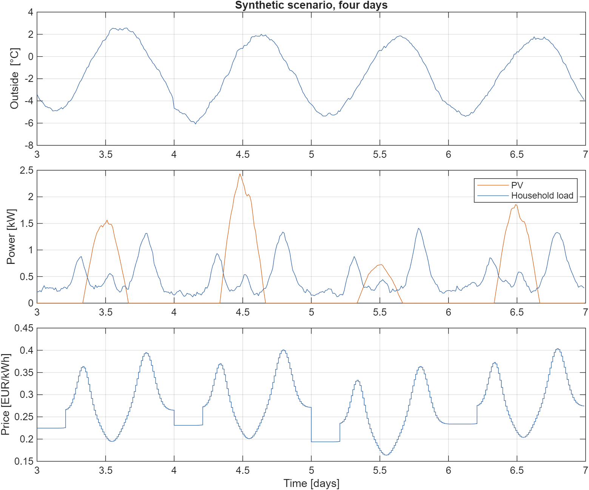
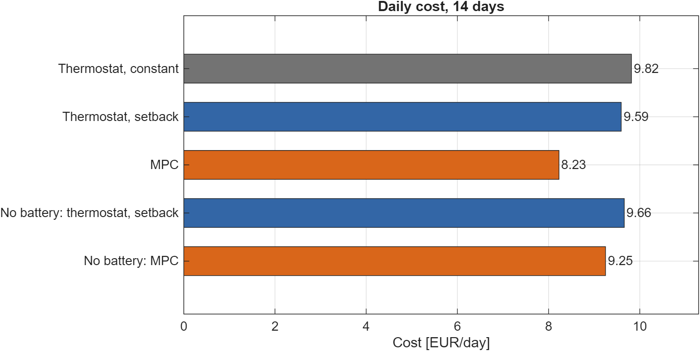
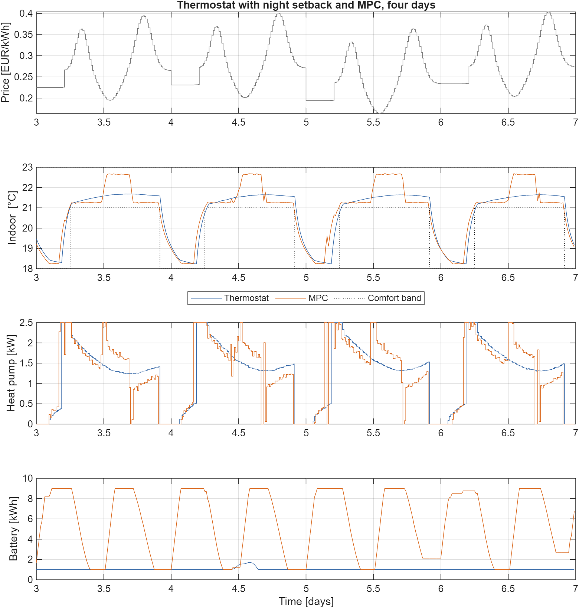
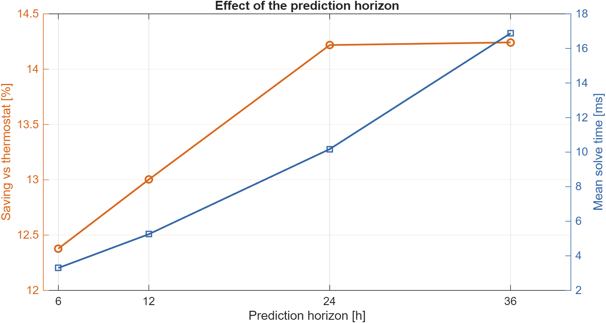
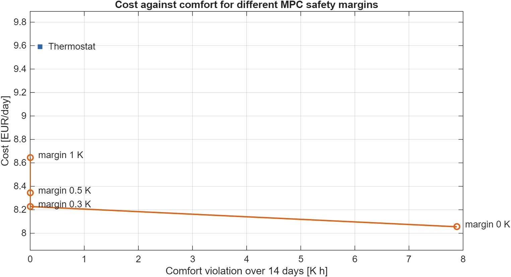
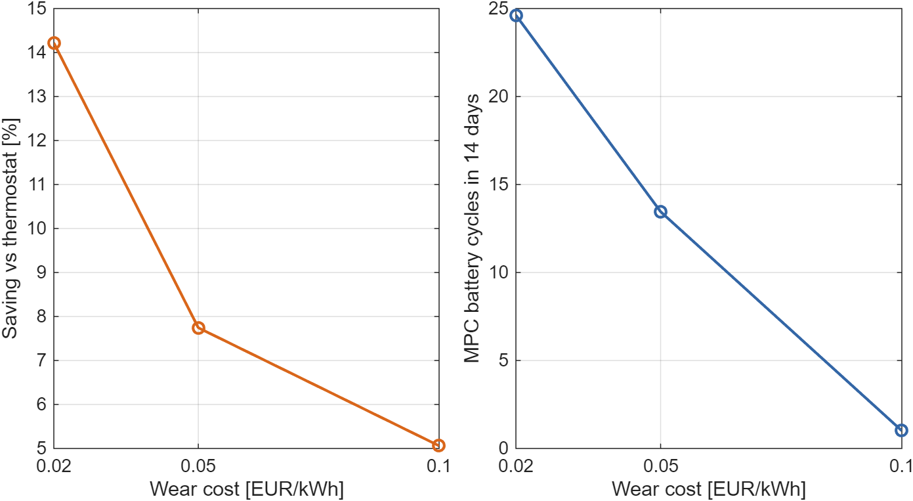

# Model predictive control for a home energy system

A MATLAB study of model predictive control (MPC) for a house with a heat pump, a home battery and rooftop PV on a dynamic electricity tariff. Every 15 minutes the controller solves a linear program over the next 24 hours, applies the first step and plans again. It is compared with two thermostat baselines in a closed-loop simulation with forecast errors and a house that loses more heat than the controller thinks.

Status: in development. The simulation study is finished. Real weather and price data, a state estimator and a Simulink model are still to do.

All data in this repository are synthetic. The results describe this simulated house, not a real building.

## Setup

**Building.** A two-state RC model with the room air and the building mass as states, discretised exactly with a zero-order hold. The mass stores heat, so the MPC can pre-heat in cheap hours.

**Heat pump.** Up to 2.5 kW electric, with a COP that rises with the outside temperature (2.2 to 4.2).

**Battery.** A usable window of 8 kWh (1 to 9 kWh), 5 kW, 95 % efficiency each way, and a wear cost of 0.02 EUR per kWh of throughput.

**Scenario.** 14 winter days at 15 minute resolution: outside temperature, a 5 kWp PV system, household load and a dynamic tariff between 0.12 and 0.60 EUR/kWh. Feed-in pays 0.08 EUR/kWh.

**Comfort band.** 21 to 23 degC from 06:00 to 22:00, 18 to 23 degC at night.



## Controllers

**Thermostat, constant setpoint.** A proportional controller holding about 22 degC. The battery stores PV surplus and covers the household load, without looking at prices.

**Thermostat, night setback.** The same, with the setpoint lowered to 18.5 degC from 22:00 and heating restarting at 04:30. This is the reference for all savings below.

**MPC.** At every step it solves a linear program with `linprog`: 960 variables for a 24 hour horizon. The variables are heat pump power, battery charge and discharge, grid import and export, both temperatures, battery energy and slack variables for the comfort band. The cost is grid cost minus feed-in revenue, battery wear, a penalty on comfort slack and a value on the battery energy left at the end of the horizon. The comfort band is tightened by a margin of 0.3 K.

**Forecasts and mismatch.** In the noisy runs the MPC sees forecasts of outside temperature, PV power and load with errors that grow with the lead time and are correlated along the horizon. Prices are known. The simulated house loses 10 % more heat than the MPC model assumes, and the MPC measures the full state at every step.

## Results

14 days, one scenario. Savings are relative to the thermostat with night setback. Comfort violation is the time integral of the distance to the band, in kelvin hours.

| Controller | Cost [EUR/day] | Saving [%] | Comfort violation [K h] | Max violation [K] | Battery cycles | Solve time [ms] |
|---|---|---|---|---|---|---|
| Thermostat, constant setpoint | 9.82 | -2.3 | 0.00 | 0.00 | 1.7 | - |
| Thermostat, night setback | 9.59 | - | 0.18 | 0.26 | 1.0 | - |
| MPC, perfect forecast | 8.14 | 15.2 | 0.00 | 0.00 | 23.9 | 20 |
| MPC, noisy forecast, seed 7 | 8.23 | 14.2 | 0.00 | 0.00 | 24.6 | 18 |
| MPC, noisy forecast, seed 8 | 8.23 | 14.1 | 0.00 | 0.01 | 24.6 | 15 |
| MPC, noisy forecast, seed 9 | 8.23 | 14.2 | 0.00 | 0.00 | 24.9 | 16 |
| No battery: thermostat, night setback | 9.66 | - | 0.18 | 0.26 | 0.0 | - |
| No battery: MPC, noisy forecast, seed 7 | 9.25 | 4.3 | 0.00 | 0.00 | 0.0 | 6 |

Battery cycles are equivalent full cycles over the 14 days. Solve time is the mean per step.



The MPC is about 14 % cheaper than the best thermostat, and forecast errors cost about one percentage point. Most of the saving comes from the battery. Without it, smarter heating alone saves 4.3 %. The next sections show how sensitive the numbers are.



The plot shows the strategy: the MPC fills the battery in cheap hours and empties it in the price peaks, lets the house run at the lower comfort limit in the evening, and uses midday PV to warm the building above the lower limit.

### Prediction horizon

| Horizon | Cost [EUR/day] | Saving [%] | Comfort violation [K h] | Solve time [ms] |
|---|---|---|---|---|
| 6 h | 8.40 | 12.4 | 0.02 | 6 |
| 12 h | 8.34 | 13.0 | 0.02 | 5 |
| 24 h | 8.23 | 14.2 | 0.00 | 18 |
| 36 h | 8.23 | 14.2 | 0.00 | 27 |

Beyond 24 hours there is nothing more to gain in this scenario, while the solve time keeps growing.



### Comfort margin

The MPC plans on the edge of the comfort band, so the model mismatch shows up as small violations. Planning with a margin inside the band removes them at a cost.

| Margin [K] | Cost [EUR/day] | Saving [%] | Comfort violation [K h] | Max violation [K] |
|---|---|---|---|---|
| 0.0 | 8.06 | 16.0 | 7.88 | 0.26 |
| 0.3 | 8.23 | 14.2 | 0.00 | 0.00 |
| 0.5 | 8.34 | 13.0 | 0.00 | 0.00 |
| 1.0 | 8.65 | 9.9 | 0.00 | 0.00 |



### Battery wear cost

The battery saving depends strongly on what a kWh of throughput costs.

| Wear cost [EUR/kWh] | Thermostat [EUR/day] | MPC [EUR/day] | Saving [%] | MPC battery cycles |
|---|---|---|---|---|
| 0.02 | 9.59 | 8.23 | 14.2 | 24.6 |
| 0.05 | 9.62 | 8.87 | 7.7 | 13.5 |
| 0.10 | 9.67 | 9.18 | 5.1 | 1.0 |

At 0.10 EUR/kWh the MPC stops cycling the battery for price arbitrage, and what remains is the heating saving.



## Limitations

- One synthetic scenario of 14 days. The three seeds only change the forecast errors.
- A simple linear building model, a COP that depends only on the outside temperature, no solar gains through windows and no hot water.
- The battery ageing model is a linear cost per kWh.
- The MPC is given the full state, and the mass temperature of a real building is not measured.
- Prices are known over the whole horizon.
- The mismatch is only a 10 % higher heat loss.
- Nothing was run on real hardware.

## Repository

| Path | Content |
|---|---|
| `src/hems_params.m` | parameters |
| `src/hems_model.m` | discrete building model |
| `src/generate_scenario.m` | synthetic weather, PV, load and tariff |
| `src/make_forecast.m` | perfect and noisy forecasts for the MPC |
| `src/build_mpc_lp.m` | one MPC step as a linear program |
| `src/simulate_hems.m` | closed-loop simulation of the controllers |
| `src/compute_metrics.m` | cost, comfort, battery and timing metrics |
| `tests/test_hems.m` | model, power balance, comfort and cost checks |
| `run_study.m` | the full study, writes `results/` |
| `results/` | `summary.csv`, `tables.md` and the figures |

## Running it

Needs MATLAB with the Optimization Toolbox. Developed on R2025b.

```matlab
addpath tests
test_hems     % about 1 minute
run_study     % about 10 minutes
```
